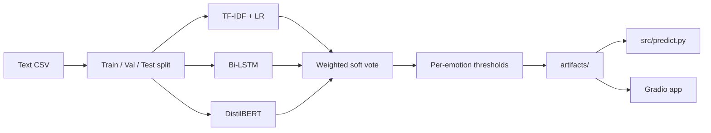
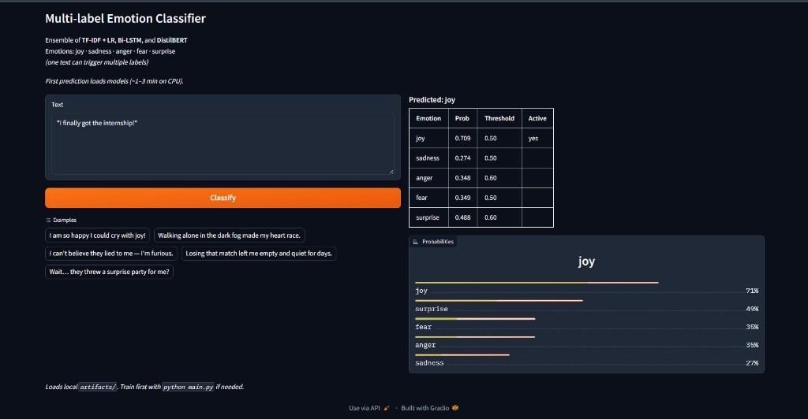
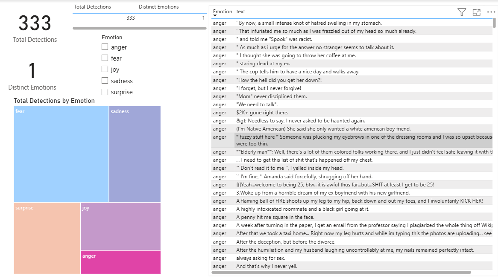

# Multi-Label Emotion Classification

Classify short English texts into one or more of five emotions:
**joy**, **sadness**, **anger**, **fear**, and **surprise**.

The project trains an ensemble of classical and deep models, saves the artifacts, and exposes inference through a CLI and a Gradio web app. An optional Power BI report can visualize batch prediction CSVs.

| | |
|---|---|
| **Task** | Multi-label text classification |
| **DistilBERT** | Macro-F1 **0.667** |
| **Ensemble** | Macro-F1 **0.662** (validation-weighted soft vote) |
| **Demo** | `python -m src.app` → http://127.0.0.1:7860 |
| **Stack** | scikit-learn, TensorFlow/Keras, Hugging Face Transformers, Gradio |

For pipeline details, see [docs/ARCHITECTURE.md](docs/ARCHITECTURE.md).

## Architecture



**Train once** (`src/main.py`) → save models → **infer** via CLI or the web demo. No new models are trained at prediction time.

---

## Overview

Emotion labels in this dataset are not mutually exclusive: a single sentence can be both *fear* and *surprise*, or carry no emotion at all. The models therefore output five independent probabilities (sigmoid heads / one-vs-rest), and decisions use per-emotion thresholds rather than a single argmax.

**Approach**

1. Split data with a cluster-aware scheme that preserves label co-occurrence  
2. Train three models: TF-IDF + logistic regression, Bi-LSTM + attention, DistilBERT  
3. Combine probabilities with soft voting weighted by each model’s validation Macro-F1  
4. Tune a decision threshold per emotion on the validation set  
5. Persist models and metadata under `artifacts/` for reuse  

**Imbalance** is handled with `class_weight='balanced'` for logistic regression and a weighted binary cross-entropy loss for the neural models. **Macro-F1** is the main metric so rare labels (especially *anger*) are not ignored.

---

## Results

Hold-out test performance on `data/track-a.csv` (cluster-aware split):

| Model | Macro-F1 |
|-------|----------|
| TF-IDF + Logistic Regression | 0.419 |
| Bi-LSTM + Attention | 0.293 |
| DistilBERT | **0.667** |
| Ensemble (weighted soft vote + tuned thresholds) | **0.662** |

Soft-vote weights (from validation Macro-F1): TF-IDF **0.35**, Bi-LSTM **0.20**, DistilBERT **0.46**.

### Why DistilBERT beats the ensemble

Soft voting averages probabilities across models. DistilBERT (0.667) is far ahead of TF-IDF (0.419) and Bi-LSTM (0.293). Even with validation-based weights (~46% DistilBERT), the weaker models still pull the blended scores away from DistilBERT’s better-calibrated outputs, and thresholds are tuned on that blend—not on DistilBERT alone. Ensembles help most when members are similarly strong with complementary errors; here the gap is large, so averaging adds a little noise instead of a gain. The ensemble is kept as a baseline comparison and a more stable multi-view predictor, while DistilBERT remains the best single system.

---

## Demo



```bash
python -m src.app
```

Open http://127.0.0.1:7860. Requires a prior `python -m src.main` so `artifacts/` exists. The first Classify loads models (slow on CPU); later requests are faster.

---

## Setup

Requires **Python 3.10–3.11** (TensorFlow 2.15 does not support 3.12+).

```bash
git clone https://github.com/mansabhairodagi/Multi-Label-Emotion-Classifier.git
cd Multi-Label-Emotion-Classifier
python -m venv .venv

# Windows
.venv\Scripts\activate

# Linux / macOS
# source .venv/bin/activate

pip install -r requirements.txt
```

---

## Usage

### 1. Train and save artifacts

```bash
python -m src.main
# optional: python -m src.main --data data/track-a.csv --out artifacts
```

Writes models, tokenizers, thresholds, and ensemble weights to `artifacts/`.  
DistilBERT fine-tuning on CPU typically takes **45–60+ minutes**.

### 2. Predict (no retraining)

```bash
python -m src.predict --text "I am so happy I could cry"
python -m src.predict data/track-a-test.csv
```

CSV output includes `predicted_labels` and per-emotion probabilities (`prob_joy`, …).

### 3. Gradio app

See [Demo](#demo) above.

### 4. Power BI (optional)

Load a prediction CSV into `dashboards/Text_Emotion_Analytics.pbix` for interactive filtering by emotion.



---

## Repository layout

```text
├── src/
│   ├── main.py                 # Training + evaluation + artifact export
│   ├── predict.py              # Inference CLI
│   ├── app.py                  # Gradio UI
│   └── emotion_model.py        # DistilBERT model + save/load helpers
├── data/
│   ├── track-a.csv             # Training data
│   └── track-a-test.csv        # Sample texts for inference
├── docs/
│   ├── ARCHITECTURE.md         # Pipeline and design notes
│   └── images/                 # Demo and dashboard screenshots
├── experiments/
│   └── DistillBERT.py          # Alternate PyTorch trainer (optional)
├── dashboards/
│   └── Text_Emotion_Analytics.pbix
├── requirements.txt
└── artifacts/                  # Produced by training (gitignored)
```

---

## Data format

```csv
id,text,anger,fear,joy,sadness,surprise
eng_train_track_a_00001,"Colorado, middle of nowhere.",0,1,0,0,1
```

Columns `anger`–`surprise` are binary indicators. The schema follows SemEval-style Track A English emotion data.

---

## Pipeline

1. Cluster-aware train / validation / test split (K-Means on the label matrix)  
2. TF-IDF (unigrams + bigrams) + one-vs-rest logistic regression  
3. Bi-LSTM with self-attention (weighted BCE)  
4. DistilBERT fine-tuning (`distilbert-base-uncased`)  
5. Soft-vote average weighted by validation Macro-F1  
6. Per-label threshold search on validation F1  
7. Export `artifacts/` → CLI and Gradio inference  

---

## License

MIT — see [LICENSE](LICENSE).

---

## Troubleshooting

| Issue | What to do |
|-------|------------|
| Missing `artifacts/` | Run `python -m src.main` before `src.predict` or `src.app` |
| Slow training or first Gradio load | Expected on CPU; DistilBERT weights are large |
| Weak *anger* scores | Rarest class; class weights and thresholds help but F1 stays lowest |
| Gradio / template errors | Install the pinned versions in `requirements.txt` |
